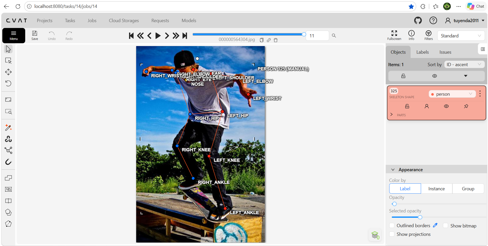
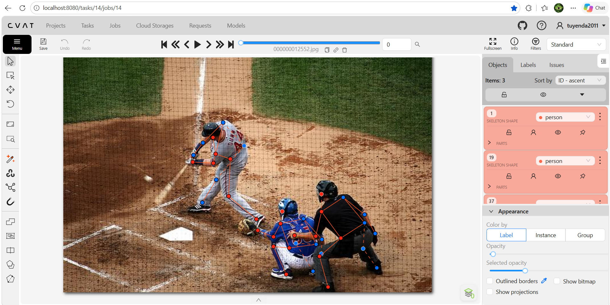
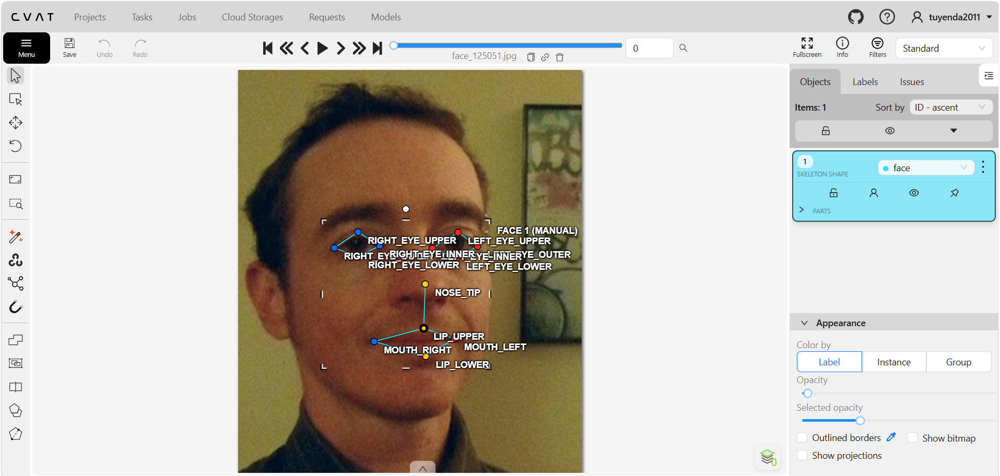
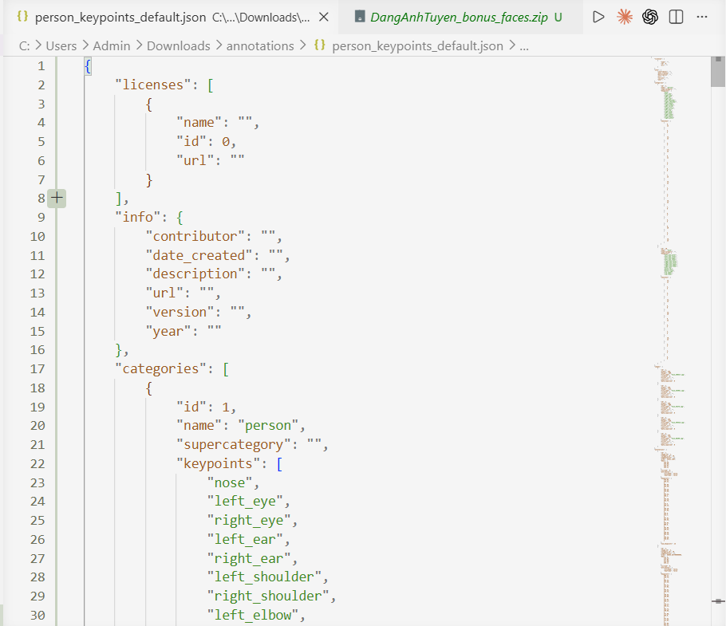

# Báo cáo cá nhân — Dang Anh Tuyen — 2A202603039

Dữ liệu gồm 12 ảnh người và 8 ảnh khuôn mặt cắt từ COCO 2017, được chia theo MSSV. Phần bonus gồm 3 ảnh người khó và 5 ảnh khuôn mặt đen trắng. Nguồn và giấy phép từng ảnh nằm trong `src/lab/pool.json` và `src/lab/NGUON_ANH.md`.

## 0. Thông tin học viên

- Họ tên: Dang Anh Tuyen
- MSSV: 2A202603039
- Email: 26ai.tuyenda@vinuni.edu.vn
- Link repository: https://github.com/tuyenda2011/K5-L2A-Day4-Dang-Anh-Tuyen-2A202603039-KeypointPose-Student
- Phiên bản CVAT: 2.82.1
- Máy: Windows 11 · RAM hệ thống 16 GB · CVAT chạy chế độ đầy đủ.
- Bộ ảnh: có `src/exports/assignment.json`, pool version `d04-k5-v2`, tài khoản CVAT `tuyenda2011`.
- Giờ bắt đầu: 17:20, ngày 12/11/2026, GMT+7.
- Giờ kết thúc: 21:00, ngày 12/11/2026, GMT+7.
- Tổng thời gian thực hiện: 220 phút.

## 1. Kiểm tra label (CP0)

| Label | Kiểu | Số điểm | Tên điểm đúng bảng của lab? | Đúng thứ tự? | Số cạnh |
|---|---|---:|---|---|---:|
| `person` | Skeleton | 17 | Khớp schema và file xuất | Khớp schema | 19 |
| `face` | Skeleton | 13 | Khớp schema và file xuất | Khớp schema | 13 |

Mẫu `person` dựng theo người quay mặt về camera. Trong cấu hình skeleton của project, các điểm `left_*` nằm bên phải khung mẫu, các điểm `right_*` nằm bên trái. Khi gán ảnh người quay lưng, trái/phải được xác định lại theo chính người trong ảnh.

Cách đổi cờ `occluded` / `outside` cho **một điểm** trên phiên bản CVAT này (một câu):

Rê chuột vào đúng điểm cần đổi, nhấn `Q` để bật/tắt `occluded`, nhấn `O` để bật/tắt `outside`, rồi nhấn `Ctrl+S` để lưu.

## 2. Số lượng đã gán và thời gian (CP1, CP2)

| Nhóm ảnh | Số ảnh | Số skeleton đã gán | Số người dưới 60 px (không gán) | Số poster / gương / màn hình bỏ qua | Thời gian (phút) |
|---|---:|---:|---:|---:|---:|
| `easy` | 5 | 5 | - | - | - |
| `occluded` | 3 | 6 | - | - | - |
| `back` | 2 | 2 | - | - | - |
| `small` | 1 | 3 | - | - | - |
| `crowd` | 1 | 3 | - | - | - |
| `faces` | 8 | 8 | - | - | - |
| **Toàn buổi** | - | - | - | - | **220** |

File người hiện có 19 skeleton trong 12 ảnh. README của bài yêu cầu 20 người, cần rà lại đủ người trước khi hoàn tất bài nộp.

- Số ảnh người đã xong ở mốc phút 105: không ghi lại tại thời điểm đó.
- Thời gian CP1, CP2 và CP3: không tách riêng; tổng thời gian ghi nhận cho buổi làm bài là 220 phút.
- Nhóm cần tập trung nhiều hơn: `small` và `back`. Thời gian từng ảnh chưa được ghi riêng nên chưa xác định được ảnh tốn thời gian nhất.

Phần người khó chủ yếu ở những người có kích thước nhỏ và người quay lưng. Với người nhỏ, vùng mặt và các khớp chỉ chiếm ít pixel nên khó xác định tâm điểm. Với người quay lưng, việc xác định trái/phải và đặt cờ cho mũi, mắt, cổ tay hoặc cổ chân bị khuất cần được cân nhắc kỹ hơn. Phần khuôn mặt có các vị trí mắt, mũi và miệng tương đối rõ, em không gặp khó khăn đáng kể.

## 3. Bảng ca khó (CP1, CP2)

Các ca dưới đây minh họa hai khó khăn chính là người nhỏ và người quay lưng. Cột cờ phản ánh dữ liệu đang có trong file xuất.

| Ảnh | Người / mặt | Điểm | Cờ đã chọn | Phân vân giữa | Lý do chọn |
|---|---|---|---:|---|---|
| `000000269462.jpg` | Người cưỡi ngựa bên trái, annotation ID 7 | Mũi và hai mắt | 0 | `v=0` / `v=1` | Người ở xa và quay lưng, khuôn mặt không thấy rõ để ước lượng chắc vị trí mũi và mắt. |
| `000000269462.jpg` | Người cưỡi ngựa ở giữa, annotation ID 8 | Khuỷu tay phải | 1 | `v=1` / `v=0` | Kích thước người nhỏ và tay bị khuất một phần. File hiện đặt `v=1`, cần dựa vào vai và phần cánh tay còn thấy để đối chiếu vị trí. |
| `000000359340.jpg` | Người đội mũ đỏ quay lưng, annotation ID 16 | Mũi và hai mắt | 0 | `v=0` / `v=1` | Người quay lưng, vùng mặt không thấy rõ. Việc đặt một vị trí ước lượng chắc cho mũi và mắt khó hơn các khớp trên thân. |
| `000000043719.jpg` | Người cầm ô quay lưng, annotation ID 4 | Cổ tay và cổ chân hai bên | 0 | `v=0` / `v=1` | Cổ tay bị thân người hoặc đồ vật che, cổ chân nằm ngoài khung ảnh. Các điểm này cần phân biệt với khớp bị che nhưng vẫn có thể ước lượng chắc. |

Phần khuôn mặt không có ca khó đặc biệt theo trải nghiệm của em. Ảnh kính râm cần chú ý cờ che khuất của các điểm mắt theo guideline.

## 4. Bảng tự review (CP3)

Phạm vi rà soát gồm 5 ảnh người và 3 ảnh mặt. Hai ảnh `000000359340.jpg` và `000000012552.jpg` thuộc nhóm `back` và `crowd`. Bảng dưới đối chiếu ảnh gốc với hiện trạng file xuất; các cảnh báo trái/phải vẫn cần xác nhận trực tiếp trên CVAT trước khi kết luận đã sửa.

Mã lỗi dùng đúng một trong: `lr_swap`, `vis_flag`, `position`, `missing`, `extra`, `ok`.

| Ảnh | Người / mặt | Điểm | Mã lỗi | Ghi chú | Đã sửa? |
|---|---|---|---|---|---|
| `000000359340.jpg` | Người chính quay lưng và người ở góc trên bên phải | Số người cần gán | `missing` | Ảnh còn có người ở góc trên bên phải, file hiện có một skeleton. Cần rà người này theo ngưỡng 60 px và đối chiếu với tổng 20 người của đề. | Chưa xác nhận xử lý |
| `000000269462.jpg` | Ba người cưỡi ngựa | Mũi, mắt và các khớp bị khuất | `ok` | File có ba skeleton; mũi và hai mắt của cả ba người đang là `v=0`. Đây là nhóm cần phóng to và kiểm tra kỹ vì người nhỏ, quay lưng. | Đã đối chiếu cấu trúc và cờ trong file |
| `000000012552.jpg` | Skeleton #3 theo script | Cổ chân hai bên | `lr_swap` | Script cảnh báo cặp ankle ngược phía so với các cặp còn lại. Cần đối chiếu tư thế thật và đường đi của từng chân. | Còn cảnh báo trong file xuất |
| `000000311497.jpg` | Skeleton #2 theo script | Gối và cổ chân hai bên | `lr_swap` | Script cảnh báo knee, ankle. Tư thế bước chân cần được kiểm tra từ hông xuống để xác định đúng bên. | Còn cảnh báo trong file xuất |
| `000000343057.jpg` | Skeleton #1 theo script | Gối và cổ chân hai bên | `lr_swap` | Script cảnh báo knee, ankle. Quần áo và giày trượt tuyết làm việc xác định tâm khớp cần được kiểm tra kỹ. | Còn cảnh báo trong file xuất |
| `face_125051.jpg` | Một khuôn mặt | Bộ 13 điểm | `ok` | Có đủ 13 điểm theo schema, `num_keypoints=13`, các điểm đang có `v=2`. Phần mặt này không gây khó khăn đáng kể. | Đã đối chiếu file xuất |
| `face_362568.jpg` | Một khuôn mặt | Mắt, mũi và miệng | `ok` | Có một skeleton 13 điểm, đủ tên theo schema, các điểm đang có `v=2`. | Đã đối chiếu file xuất |
| `face_256814.jpg` | Khuôn mặt đeo kính râm | Tám điểm ở hai mắt | `ok` | Tám điểm mắt có `v=1`, năm điểm mũi và miệng có `v=2`, phù hợp quy tắc cờ cho kính râm tối của lab. | Đã đối chiếu cờ trong file |

Tổng hợp số dòng theo mã trong bảng rà soát. Ba dòng `lr_swap` là cảnh báo cần xác nhận, dòng `missing` là trường hợp cần rà thêm người trong ảnh.

| `lr_swap` | `vis_flag` | `position` | `missing` | `extra` | `ok` |
|---:|---:|---:|---:|---:|---:|
| 3 | 0 | 0 | 1 | 0 | 4 |

Điểm cần phân biệt rõ giữa `v=1` và `v=0`

Ở người nhỏ và người quay lưng, một khớp bị khuất có thể đặt `v=1` khi vị trí còn được xác định chắc từ các khớp lân cận. Nếu ảnh quá nhỏ, khuôn mặt quay hẳn đi hoặc khớp nằm ngoài ảnh, `v=0` phù hợp hơn. Các ví dụ đang có trong file là khuỷu tay phải của người ở giữa ảnh `000000269462.jpg` với `v=1`, và mũi, mắt của người quay lưng trong ảnh `000000359340.jpg` với `v=0`.

## 5. Kiểm file xuất và kết quả tự kiểm (CP4)

Kết quả đối chiếu cấu trúc trên các file JSON xuất được trình bày dưới đây. Khi rà lại trực tiếp trên CVAT, cần đối chiếu cả vị trí điểm và cờ với ảnh gốc.

| File | Người / mặt kiểm (ảnh, thứ tự) | Số phần tử `keypoints` | Điểm `outside` ra `v = 0`, `occluded` ra `v = 1`? | `num_keypoints` khớp? |
|---|---|---:|---|---|
| `DangAnhTuyen_persons.zip` | `000000012552.jpg`, annotation ID 1 | 51 | Có cả `v=0` và `v=1` trong file xuất | Có, 13 điểm `v>0` |
| `DangAnhTuyen_persons.zip` | `000000012552.jpg`, annotation ID 2 | 51 | Có cả `v=0` và `v=1` trong file xuất | Có, 13 điểm `v>0` |
| `DangAnhTuyen_faces.zip` | `face_125051.jpg`, annotation ID 1 | 39 | Annotation này có 13 điểm `v=2` | Có, 13 điểm `v>0` |

Theo quy ước CVAT của lab, `occluded` xuất thành `v=1`, `outside` xuất thành `v=0`. File người hiện có 58 điểm `v=0` vẫn mang tọa độ cũ. `num_keypoints` được kiểm bằng số điểm có `v>0`.

Hai job chính đã chuyển sang completed trên CVAT? Tại thời điểm đối chiếu, job 14 và 15 đều ở trạng thái `in progress`.

Dán phần **TÓM TẮT** in ra từ `src/check_submission.py`:

```text
- File person: DangAnhTuyen_persons.zip
  Số ảnh: 12 · số skeleton person: 19 · mỗi annotation 51 số
  Skeleton theo ảnh: 000000012552=3, 000000043719=1, 000000057978=1, 000000103970=1, 000000269462=3, 000000302102=2, 000000311497=2, 000000336477=1, 000000343057=1, 000000359340=1, 000000467300=2, 000000564304=1
  Cờ v: v=2 232 (72%) · v=1 33 (10%) · v=0 58 (18%)
  num_keypoints trung bình: 13.9
- File face: DangAnhTuyen_faces.zip
  Số ảnh: 8 · số skeleton face: 8 · mỗi annotation 39 số
  Skeleton theo ảnh: face_125051=1, face_147624=1, face_186226=1, face_256814=1, face_362568=1, face_416730=1, face_476363=1, face_79367=1
  Cờ v: v=2 96 (92%) · v=1 8 (8%) · v=0 0 (0%)
  num_keypoints trung bình: 13.0
- Ghi chú: 58 điểm v=0 vẫn mang tọa độ cũ theo cách CVAT xuất dữ liệu.
- Số [LỖI]: 0 · số [CẢNH BÁO]: 3
Kết quả: ĐẠT (đọc lại từng cảnh báo ở trên)
```

Các `[CẢNH BÁO]` hiện có và hướng đối chiếu

| Ảnh | Skeleton theo thứ tự script | Cảnh báo | Kết quả đối chiếu và lý do giữ / sửa |
|---|---|---|---|
| `000000012552.jpg` | #3 | Cặp ankle ngược phía với các cặp còn lại | Cần lần từ hông xuống gối và cổ chân của người đang đánh bóng. Cảnh báo còn tồn tại trong file, chưa có kết luận về việc giữ hay đổi cặp điểm. |
| `000000311497.jpg` | #2 | Cặp knee, ankle ngược phía với các cặp còn lại | Cần phân biệt vị trí hai chân khi người đang bước. Cảnh báo còn tồn tại trong file, chưa có kết luận về việc giữ hay đổi cặp điểm. |
| `000000343057.jpg` | #1 | Cặp knee, ankle ngược phía với các cặp còn lại | Cần kiểm tra gối, giày và hướng hai chân trong tư thế trượt tuyết. Cảnh báo còn tồn tại trong file, chưa có kết luận về việc giữ hay đổi cặp điểm. |

## 6. Ảnh chụp màn hình

1. Label `person` trong label constructor (đủ 17 điểm có tên):

   

   Cần chụp lại ảnh này tại Project → Labels → label constructor. Ảnh hiện tại đang hiển thị một skeleton trên trang Job.

2. Một người quay lưng đã gán, cờ đã đặt:

   

3. Một khuôn mặt đã gán 13 điểm, phóng to vùng mắt:

   

4. Một đoạn JSON xuất của một người:

   

   Cần chụp lại vùng `annotations` của một người, thấy mảng `keypoints` gồm 51 số và trường `num_keypoints`. Ảnh hiện tại đang hiển thị phần `categories`.

Nguồn ảnh minh chứng: COCO 2017. Ảnh chụp thao tác trên CVAT và nội dung JSON xuất.

## 7. Tự đánh giá

1. Khó khăn chính và cách cải thiện

   Phần em thấy khó nhất là gán người nhỏ và người quay lưng. Người nhỏ khiến mắt, mũi, cổ tay và cổ chân khó xác định chính xác. Với người quay lưng, em cần chú ý trái/phải theo chính người trong ảnh và phân biệt khớp bị che với khớp ngoài khung hình. Em chưa có thống kê số lần mắc từng loại lỗi, nên chưa kết luận được mã lỗi nào xuất hiện nhiều nhất. Trong các bài tiếp theo, em sẽ xác định hướng người trước, phóng to vùng cần đặt điểm và rà từng chuỗi vai → khuỷu → cổ tay, hông → gối → cổ chân. Phần khuôn mặt không có khó khăn đáng kể đối với em.

2. Quy tắc đề xuất bổ sung vào guideline

   Trước khi gán từng người nhỏ hoặc quay lưng, cần xác định hướng của thân và đánh dấu các điểm ngoài ảnh trước. Sau đó mới đặt các điểm thấy rõ và ước lượng khớp bị che. Sau khi hoàn thành, rà toàn bộ cặp trái/phải một lượt thay vì kiểm từng điểm rời rạc. Ảnh `000000269462.jpg` và `000000359340.jpg` là hai ví dụ phù hợp cho quy tắc này.

3. Ảnh hưởng của nhãn tới model

   Mỗi keypoint có `v>0` cung cấp vị trí đích cho model học. Nếu điểm lệch khỏi tâm khớp, heatmap đích cũng bị lệch. Nếu tên trái/phải bị đảo, model học sai quan hệ giữa tên điểm và bộ phận cơ thể, đồng thời làm bước tăng cường dữ liệu bằng lật ảnh tạo ra nhãn sai. Nếu khớp bị che nhưng được ước lượng chắc, `v=1` giữ lại thông tin vị trí. Nếu không xác định được mà vẫn gán một điểm có `v>0`, dữ liệu huấn luyện sẽ chứa vị trí thiếu căn cứ. Vì vậy, các cảnh báo gối và cổ chân trong bài cần được đối chiếu trước khi hoàn tất nhãn.

## 8. Khó khăn và lỗi kỹ thuật

- Sử dụng Codex để hỗ trợ viết, chỉnh sửa và định dạng báo cáo Markdown (`.md`) dựa trên thông tin thực hiện bài lab và các file kết quả.
- Môi trường chạy lệnh dùng Python 3.12 trong `.venv-pose` và PowerShell trên Windows 11.
- Các file xuất đã qua kiểm tra cấu trúc với 0 lỗi. Bài chính còn 3 cảnh báo, bonus người còn 2 cảnh báo, bonus mặt có 0 cảnh báo.
- Các job 14–17 đang ở trạng thái `in progress` tại thời điểm cập nhật báo cáo.
- Ảnh minh chứng số 1 và số 4 cần chụp lại đúng nội dung yêu cầu.
- Khó khăn chính trong quá trình gán là người nhỏ và người quay lưng. Cách xử lý là phóng to vùng khớp, xác định hướng cơ thể và lần theo từng chi để kiểm tra trái/phải, sau đó đối chiếu cờ `occluded` / `outside`.
- Phần khuôn mặt không có khó khăn đáng kể. Cần duy trì việc đặt điểm ở mép mí, khóe mắt và mép môi, đồng thời đặt đúng cờ mắt bị kính râm che.

## Bonus (nếu làm)

### B1 — 3 ảnh người khó thêm

| Ảnh | Số skeleton | Số người dưới 60 px | Ca khó nhất |
|---|---:|---:|---|
| `000000104800.jpg` | 2 | - | Người ở phía sau quay lưng và bị che một phần; cần tách đúng chi của từng người. |
| `000000125998.jpg` | 5 | - | Ảnh chỉ thấy một phần thân, bàn tay và chân, bị máy tính che nhiều; cần xác định các bộ phận thuộc cùng một người. |
| `000000337458.jpg` | 3 | - | Người nhỏ ở xa và người quay lưng; cần kiểm tra phạm vi ảnh, độ lớn người và vị trí các khớp. |

Kết quả `src/check_submission.py` cho `DangAnhTuyen_bonus_persons.zip`

```text
- File person: DangAnhTuyen_bonus_persons.zip
  Số ảnh: 3 · số skeleton person: 10 · mỗi annotation 51 số
  Skeleton theo ảnh có điểm v>0: 000000104800=2, 000000125998=3, 000000337458=3
  Cờ v: v=2 75 (44%) · v=1 10 (6%) · v=0 85 (50%)
  num_keypoints trung bình: 8.5
- Ghi chú: 85 điểm v=0 vẫn mang tọa độ cũ theo cách CVAT xuất dữ liệu.
- Số [LỖI]: 0 · số [CẢNH BÁO]: 2
Kết quả: ĐẠT (đọc lại từng cảnh báo ở trên)
```

Trong 10 skeleton, có 2 skeleton ở ảnh `000000125998.jpg` có `num_keypoints=0`. Script bỏ hai skeleton này khỏi thống kê skeleton có điểm theo ảnh. Cần kiểm tra và xử lý trên CVAT, sau đó xuất và chạy kiểm tra lại.

### B2 — 5 ảnh khuôn mặt đen trắng / hồng ngoại

File `DangAnhTuyen_bonus_faces.zip` có 5 ảnh, mỗi ảnh một skeleton 13 điểm.

```text
- File face: DangAnhTuyen_bonus_faces.zip
  Số ảnh: 5 · số skeleton face: 5 · mỗi annotation 39 số
  Skeleton theo ảnh: face_296417=1, face_344941=1, face_45276=1, face_494518=1, face_68290=1
  Cờ v: v=2 61 (94%) · v=1 4 (6%) · v=0 0 (0%)
  num_keypoints trung bình: 13.0
- Số [LỖI]: 0 · số [CẢNH BÁO]: 0
Kết quả: ĐẠT
```

Phần khuôn mặt đen trắng không gây khó khăn đáng kể cho em. Dù thiếu thông tin màu, các vùng mắt, mũi và miệng vẫn có thể xác định dựa vào hình dạng và độ tương phản. Em tập trung vào mép mí mắt, khóe mắt, khóe miệng và mép môi theo cùng bộ 13 điểm của bài chính.

Với ảnh hồng ngoại, cờ của mắt sau kính râm cần dựa vào khả năng nhìn thấy thực tế. Nếu vùng mắt nhìn rõ qua tròng kính trên ảnh đang gán thì dùng `v=2`. Nếu mắt vẫn bị che nhưng vị trí có thể ước lượng chắc thì dùng `v=1`. Nếu không xác định được thì dùng `v=0`. Kết quả trong file bonus mặt hiện có 61 điểm `v=2`, 4 điểm `v=1` và 0 điểm `v=0`.

### B3 — Model so với nhãn của tôi (không tính điểm)

Hồ sơ hiện tại tập trung vào bài chính, B1 và B2. Phần B3 chưa có kết quả demo trên trình duyệt và bảng so sánh với các ảnh do coach chỉ định được ghi nhận trong báo cáo.

## 9. Tài liệu tham khảo
Các file hướng dẫn trong link repo thực hành của chương trình
